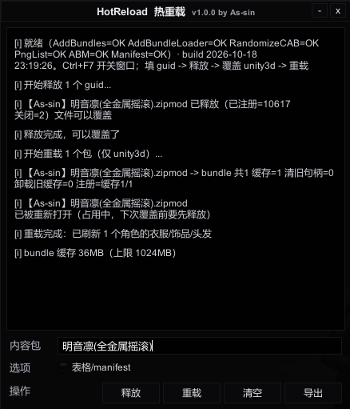

<h1 align="center">HotReload </h1>

<p align="center">
  不重启游戏，替换 zipmod 里的 <code>.unity3d</code> 后立即生效，并自动刷新场上角色的衣服/饰品/头发。
</p>

<p align="center">
  
</p>

---

## 支持环境

| 项目 | 目标 |
| --- | --- |
| `HotReload-Madevil` | Madevil / 经典 BepisPlugins（KK 18.x，`Archives`） |
| `HotReload-RX22` | HF Patch / RX22（2024+，`Zipmods`） |

反射适配，不编译依赖 `Sideloader.dll`。

---

## 安装

```
BepInEx/
├─ plugins/HotReload.Boot.dll        壳，基本不用更新
└─ hotreload/HotReload.Payload.dll   主体，日常只换这个
```

游戏运行中也能直接覆盖 payload（壳会自动重读），`Ctrl+F10` 可强制重载。

---

## 使用

1. `Ctrl+F7` 打开窗口
2. 填 guid（多个用空格 / 逗号分隔）
3. **释放** → 把新的 `xxx.unity3d` 覆盖进 zipmod → **重载**
4. 角色部件会自动重建，无需重读卡片

| 键 | 作用 |
| --- | --- |
| `Ctrl+F7` | 开关窗口 |
| `Enter` / `Ctrl+Enter` | 释放 / 重载 |
| `Ctrl+F10` | 重载 payload（改插件本体用） |

**表格/manifest**：只有改了 `list/characustom/*.csv` 或 `manifest.xml` 才勾选。

---

## 原理

- **释放**：摘注册表 → 卸加载器 → 关 zip 句柄
- **重载**：解析校验 → 把 bundle 抽到 `BepInEx/hotreload/bundle-cache` → 提交注册；失败则保留旧状态（`kept previous state`）
- 加载器指向缓存文件，Unity 不再锁 zipmod，源文件随时可覆盖
- 缓存按内容哈希，自动清理：超 **1 GB** 或 **15 天**未使用
- 刷新：`ChangeClothes / ChangeAccessory / ChangeHair(true)`，并保护 MaterialEditor 材质数据

---

## 构建

```powershell
.\build.ps1                                  # 自动探测游戏目录，编译并部署
.\build.ps1 -BootOnly                        # 只更新壳
.\build.ps1 -GameDir 'E:\game\GDAkk\Koikatu' # 指定游戏目录
```

---

## 常见问题

- **衣服/材质丢失**：看日志里 `注册=` 与 `载入OK name=...`，多半是 bundle 没注册上或 zipmod 的 AB 名不规范
- **文件仍被占用**：先点释放；仍占用就重启游戏一次
- **看不到改动**：切一次 outfit（角色用的是已实例化的 prefab）
- **列表里没有新衣服**：勾选「表格/manifest」再重载，然后切一次分类

---

## 许可

GPL-3.0-only，完整条款见 [LICENSE](LICENSE)。

实现思路参考 BepisPlugins 的 Sideloader 热重载分支（LGPL-3.0），未直接包含其源码。
